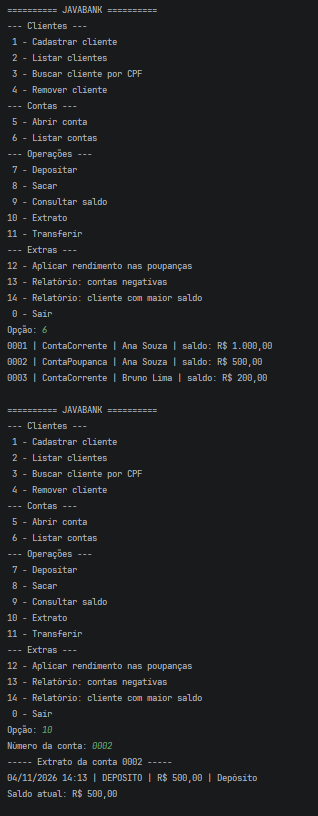
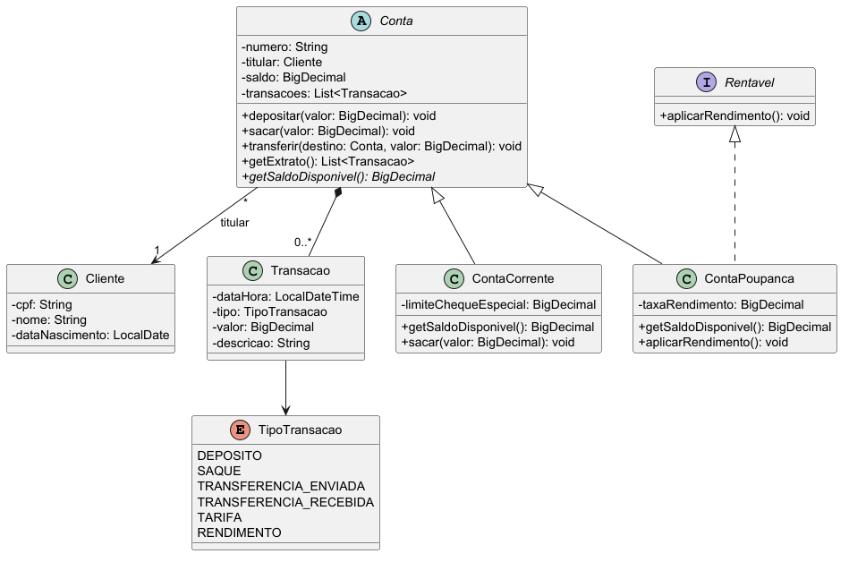

# JavaBank

Sistema bancário em Java com interface de console. Permite cadastrar clientes,
abrir contas e realizar operações como depósito, saque e transferência,
aplicando conceitos de orientação a objetos.

## Funcionalidades

- Cadastro, listagem, busca por CPF e remoção de clientes
- Validação de CPF e bloqueio de CPF duplicado
- Abertura de Conta Corrente e Conta Poupança
- Depósito, saque, transferência, consulta de saldo e extrato
- Rendimento mensal das poupanças
- Relatórios: contas negativas e cliente com maior saldo

## Regras de negócio

- Depósitos e saques devem ser maiores que zero
- Conta Corrente pode ficar negativa até o limite do cheque especial (R$ 500,00)
- Conta Poupança não pode ficar negativa
- Tarifa de R$ 2,50 a partir do 4º saque no mês na Conta Corrente
- A transferência só altera as contas se todas as validações passarem
- Cliente com contas abertas não pode ser removido
- Toda movimentação é registrada no extrato

## Conceitos aplicados

- Classe abstrata (`Conta`) e herança (`ContaCorrente`, `ContaPoupanca`)
- Polimorfismo (`getSaldoDisponivel()`)
- Interface (`Rentavel`)
- Encapsulamento e classe imutável (`Transacao`)
- Exceções personalizadas
- `BigDecimal` para valores monetários
- `ArrayList` e `enum`

## Tecnologias

- Java 26
- Maven

## Como executar

1. Clone o repositório:
   `git clone https://github.com/LucasPeloi/Java-Projects-Portfolio.git`
2. Abra a pasta `SistemaBancario` no IntelliJ IDEA
3. Execute a classe `peloi.lucas.Main`

O programa já inicia com 2 clientes e 3 contas de exemplo.

## Demonstração

## Diagrama de classes

## Estrutura

    src/main/java/peloi/lucas
    ├── model       (Cliente, Conta, ContaCorrente, ContaPoupanca, Transacao...)
    ├── exception   (exceções personalizadas)
    ├── util        (ValidadorCpf)
    └── Main.java   (menu do console)

## Próximos passos

- [ ] Persistência dos dados em arquivo ou banco (H2/SQLite)
- [ ] Testes unitários com JUnit
- [ ] Separação em camadas (repository e service)
- [ ] Autenticação com senha